<div align="center">

# omatings

**A settings app for [Omarchy](https://omarchy.org).**
Monitors, sound, Wi‑Fi, Bluetooth, themes, input, shortcuts, power. No config files, no agent.

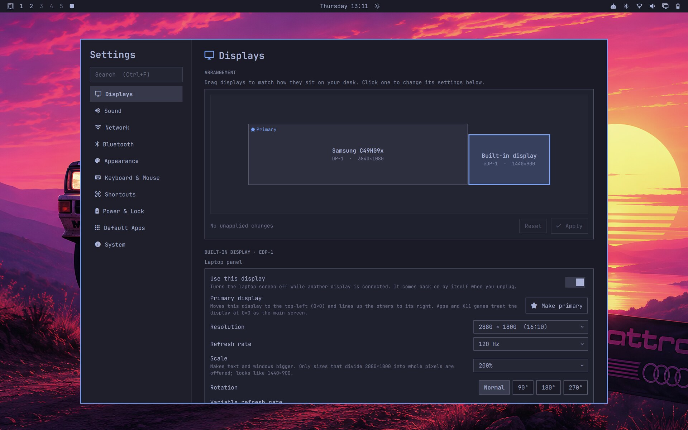

</div>

---

Plug in a new monitor. Press <kbd>Super</kbd> <kbd>I</kbd>, drag the screens into place, hit **Apply**, and keep the change. You don't edit `monitors.lua` or count pixels.

omatings is a native Omarchy shell plugin. It runs inside the `omarchy-shell` process that already draws your bar, so it opens instantly. It is built from Omarchy's own UI kit, so it looks like the rest of your desktop and **follows your theme live**.

<div align="center">
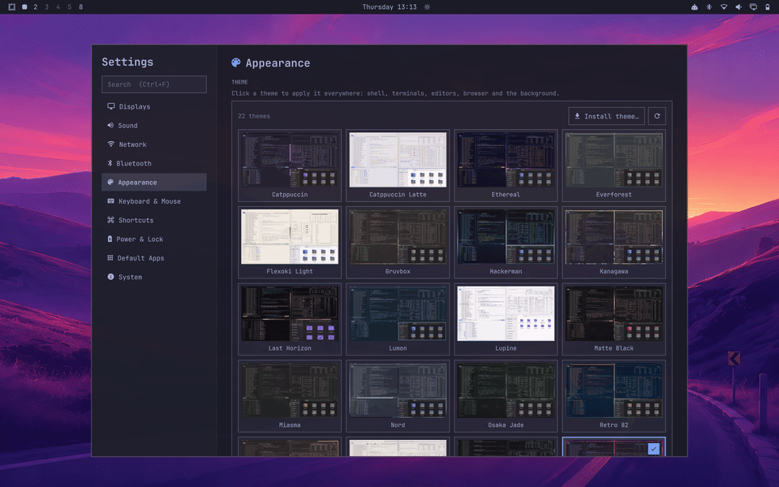
</div>

## Features

| Page | What you can do |
|---|---|
| **Displays** | Drag & drop arrangement with edge snapping · resolution, refresh rate, scale, rotation, VRR · mirror, primary, on/off · live **Apply → Keep or revert in 15 s** · brightness · night light · reacts to hotplug |
| **Sound** | Output/input devices · volume, mute, balance · live mic level · per‑app volume |
| **Network** | Wi‑Fi on/off, scan, connect (password prompt), forget, hidden networks, QR share · airplane mode · connection details · DNS provider · Tailscale status |
| **Bluetooth** | Power, discoverable · paired devices with battery · scan, pair, connect, remove |
| **Appearance** | Theme gallery · backgrounds · font · text size · gaps, borders, rounding, blur, shadows, dimming, animations |
| **Keyboard & Mouse** | Layouts & variants · compose / Caps Lock · repeat rate & delay · pointer speed, acceleration, natural scroll · touchpad tap, disable‑while‑typing, three‑finger drag |
| **Shortcuts** | Search every binding · record new shortcuts · conflict detection · disable or replace built‑ins |
| **Power & Lock** | Power profile · battery health · screensaver/lock timeouts · suspend, hibernation · lock/suspend/restart/shut down |
| **Default Apps** | Browser, editor, terminal, coding agent · file manager, image viewer, video, music, PDF |
| **System** | Hardware overview · Omarchy version & channel · updates · timezone · hostname · snapshots |

<div align="center">
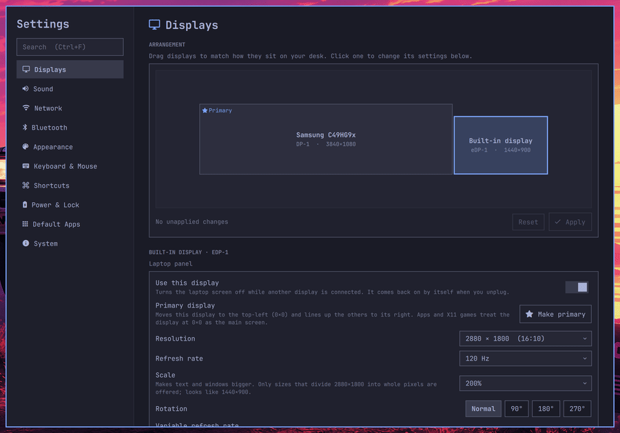
</div>

## Install

Requires Omarchy 4 (Quickshell-based shell, Hyprland Lua config).

```bash
omarchy plugin add https://github.com/parda21/omatings --enable
```

Then open it:

```bash
omarchy-shell shell toggle omatings '{}'
```

### Keybinding

Add this to `~/.config/hypr/bindings.lua`:

```lua
o.bind("SUPER + I", "Settings", "omarchy-shell shell toggle omatings '{}'")
```

You can jump straight to a page with `'{"page":"displays"}'`. Page ids are `displays`, `sound`, `network`, `bluetooth`, `appearance`, `input`, `shortcuts`, `power`, `apps` and `system`.

### Omarchy menu entry (optional)

Add this to `~/.config/omarchy/extensions/omarchy-menu.jsonc`:

```jsonc
"setup.settings": {"icon":"󰒓","label":"Settings app","action":"omarchy-shell shell toggle omatings '{}'"},
```

## How it changes your system

omatings does not take over your configs.

- **It uses Omarchy's own commands first.** Themes, fonts, power profiles, DNS, defaults, toggles and updates all go through `omarchy …`, `hyprctl`, `nmcli` and PipeWire, so it behaves like the Omarchy menu does.
- **It only writes to marked blocks.** Changes to `~/.config/hypr/*.lua` go into a clearly marked block at the end of the file. Your own lines and comments stay as they are:
  ```lua
  -- >>> omatings:monitors
  -- Managed by Omarchy Settings. Edits inside this block are overwritten.
  hl.monitor({ output = "desc:…", mode = "3840x1080@119.97", position = "0x0", scale = 1 })
  -- <<< omatings:monitors
  ```
  Delete a block, or use *Reset to Omarchy defaults* on its page, and it's gone.
- **It makes a backup and checks the result.** The first write to a file in each session creates `<file>.bak.<timestamp>`. Every write is atomic and followed by `hyprctl reload` plus a config error check.
- **Privileged actions open in a terminal.** Hostname, timezone, hibernation and updates run in a terminal, so you see exactly what runs with `sudo`.

## Screenshots

| | |
|---|---|
|  | 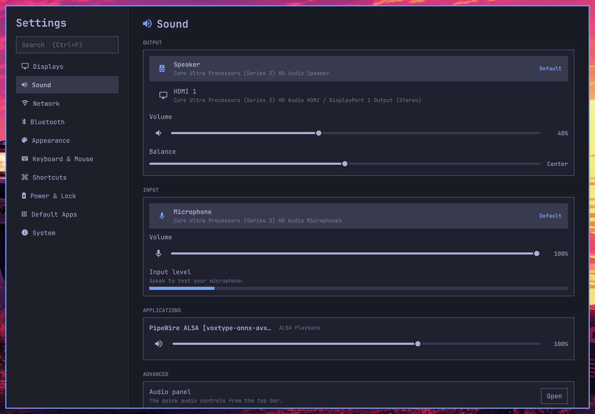 |
| 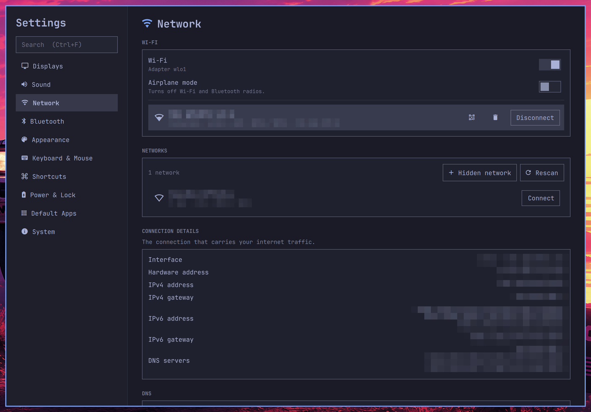 | 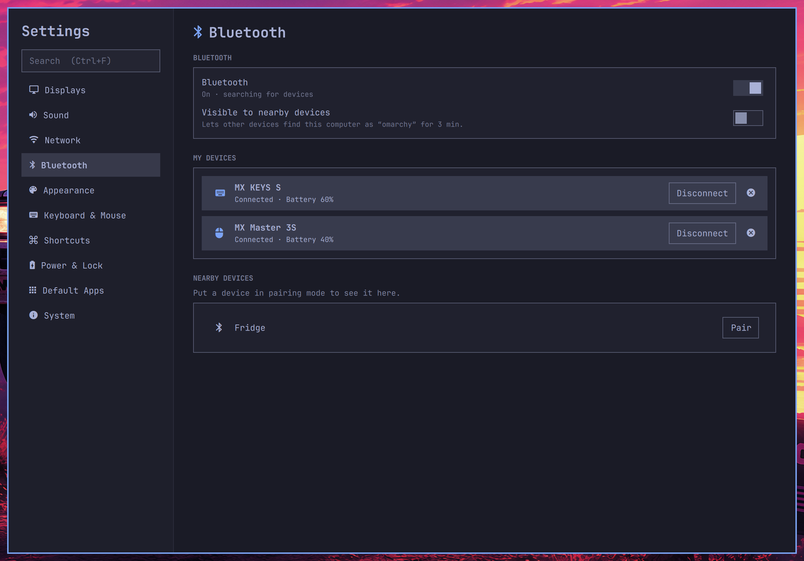 |
| 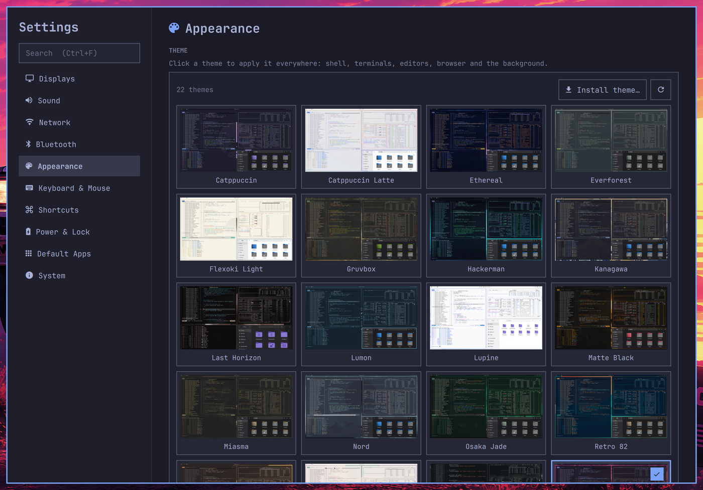 | 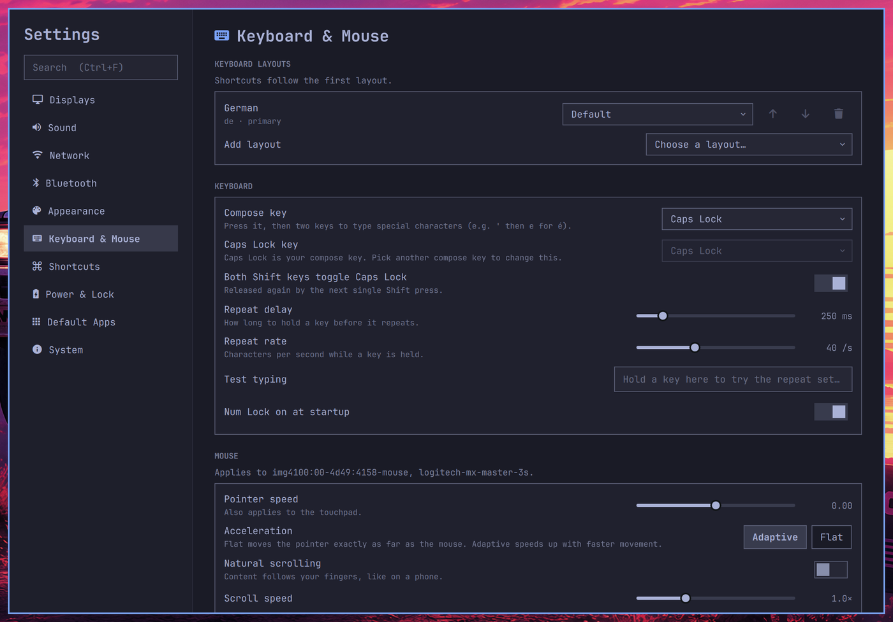 |
| 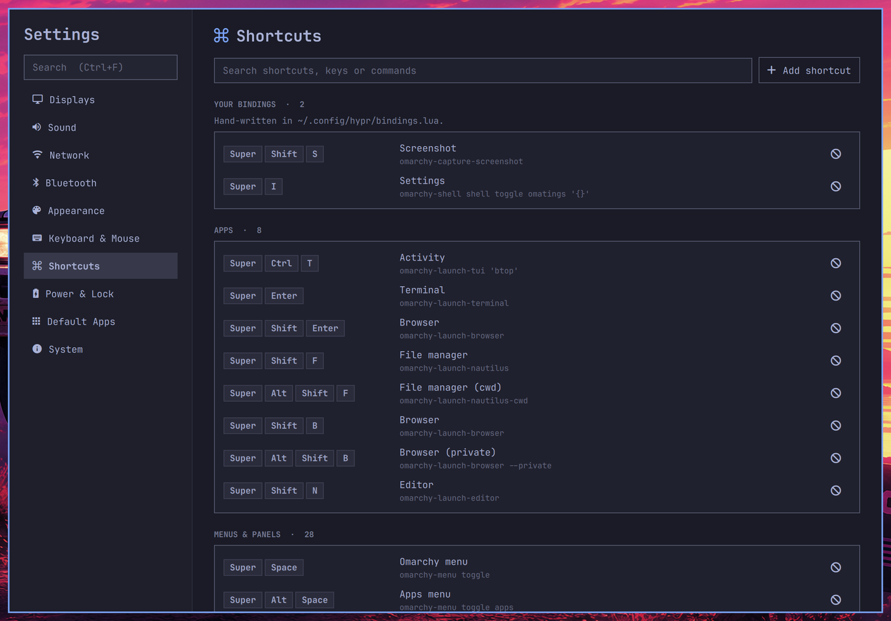 | 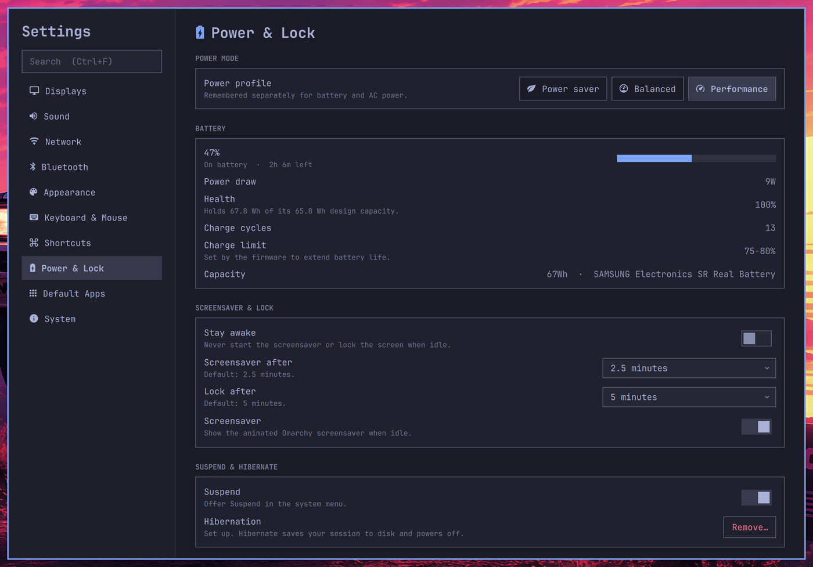 |
| 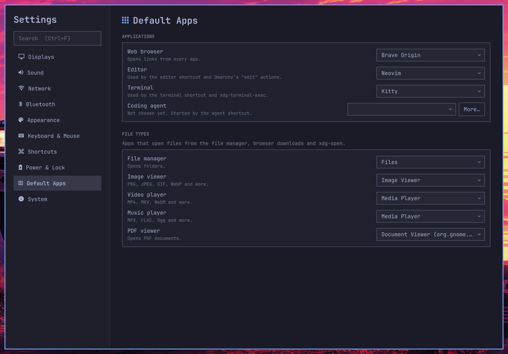 | 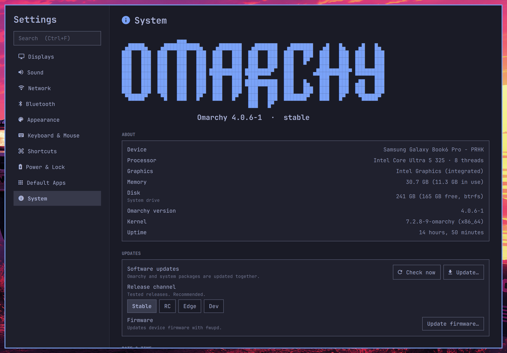 |

## Development

```bash
git clone https://github.com/parda21/omatings && cd omatings
scripts/install.sh          # symlink into ~/.config/omarchy/plugins and enable
tools/check.sh              # headless load check of every page (doesn't touch your session)
tools/check.sh tools/tests/DisplaysModelTest.qml
```

Every page is a self-contained QML file in `pages/`, with shared helpers in `Core/`. [`AGENTS.md`](AGENTS.md) has the page contract, the UI rules and the safety rules.

After changing QML, run `omarchy restart shell` to drop Quickshell's component cache.

## Status

omatings is young. It's tested on Omarchy 4.0.6 with Hyprland 0.56 on one laptop plus an external ultrawide. Issues and PRs are welcome, especially from setups with odd monitors, NVIDIA or desktop machines.

**Roadmap**

- Vim-style keyboard navigation like Omarchy's panels
- Open the Displays page automatically when a monitor is plugged in
- Display profiles for home, office and docked

## License

[MIT](LICENSE)
